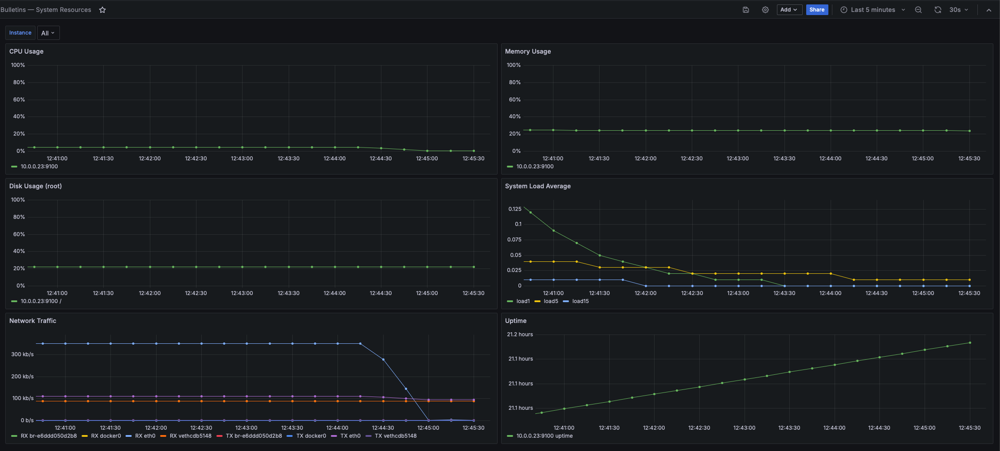
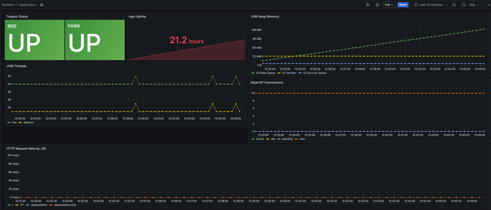
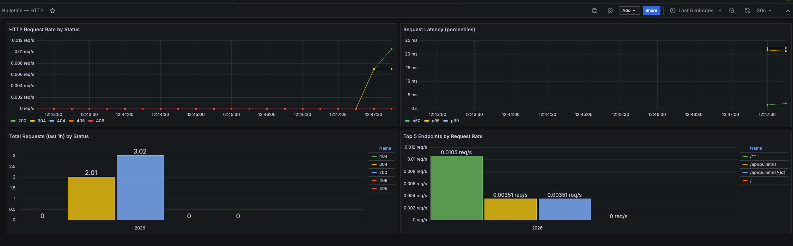
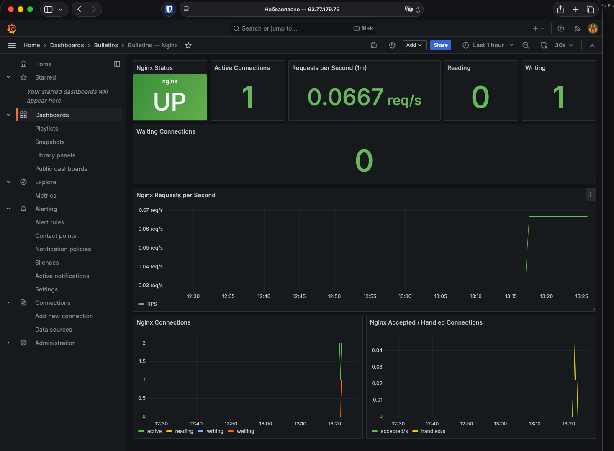
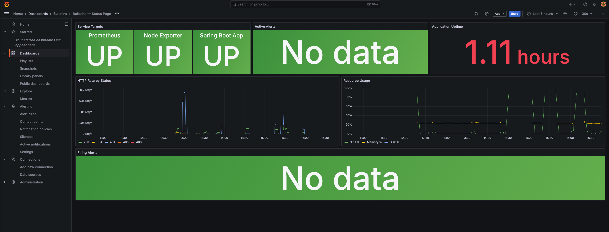
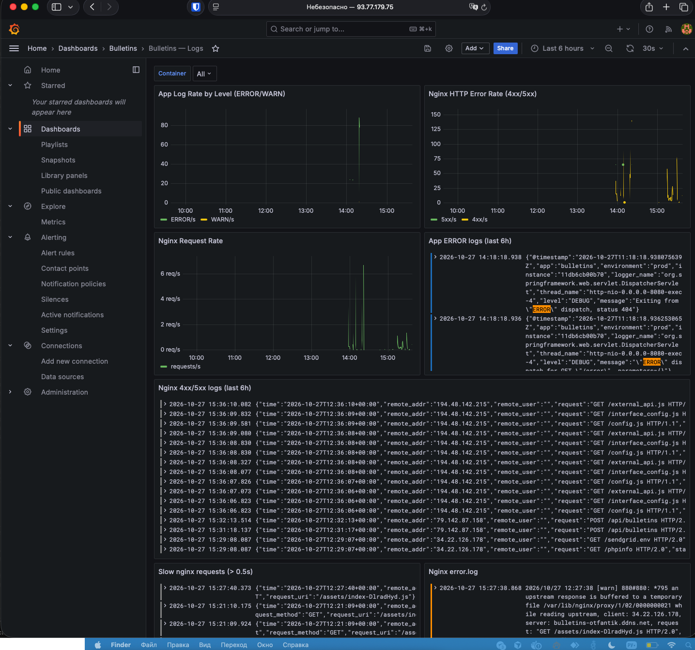
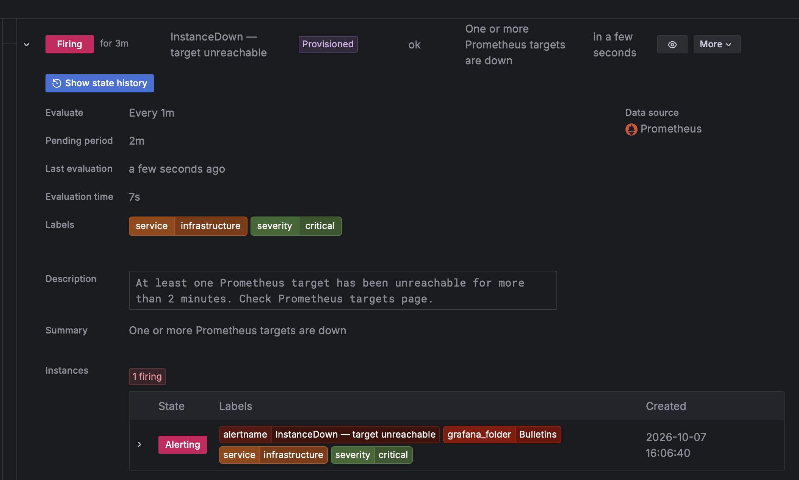
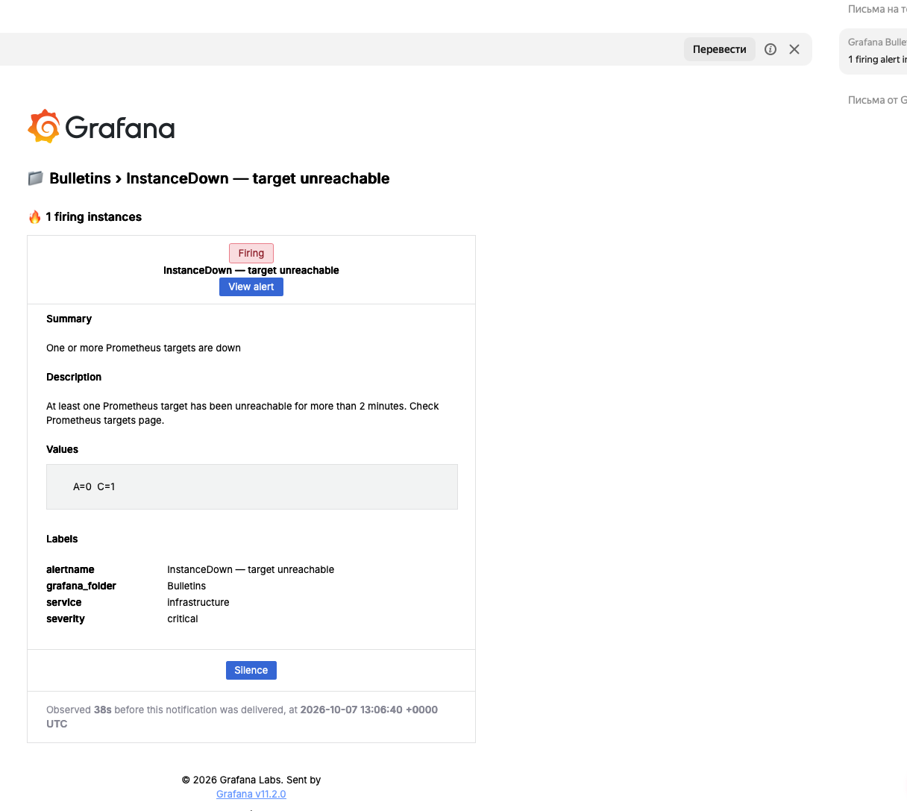
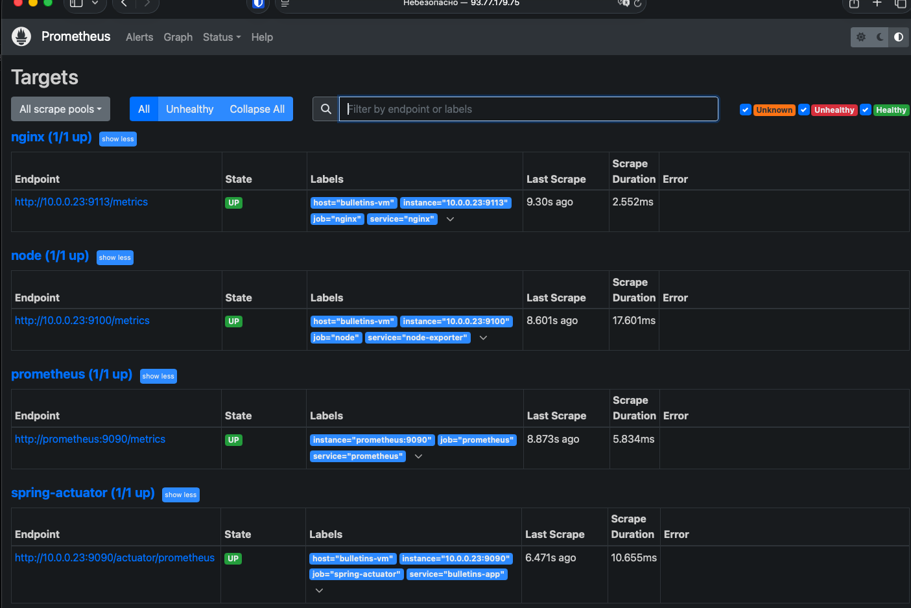

# Доска объявлений — DevOps Deployment

Infrastructure-as-Code для развёртывания приложения Bulletin Board в Yandex Cloud с полным стеком наблюдаемости: Prometheus, Grafana, Loki, алертинг на email.

## Live Demo

- **Web UI:** https://bulletins-otfantik.ddns.net
- **API:** https://bulletins-otfantik.ddns.net/api/bulletins
- **Swagger UI:** https://bulletins-otfantik.ddns.net/swagger-ui/index.html
- **Prometheus:** http://93.77.179.75:9090
- **Grafana:** http://93.77.179.75:3000 (admin / пароль из Vault)

## Архитектура

Два сервера в Yandex Cloud (VPC 10.0.0.0/24):

| Хост | Роль | Что запущено |
|---|---|---|
| bulletins-vm (10.0.0.23) | Application | nginx (80/443), Spring Boot app (8080), node_exporter (9100), nginx_exporter (9113), Promtail |
| monitoring-vm (10.0.0.34) | Observability | Prometheus (9090), Grafana (3000), Loki (3100), Alertmanager (built-in) |

Внешние managed-сервисы:

| Сервис | Назначение |
|---|---|
| Managed PostgreSQL 16 | База данных приложения (bulletins) |
| Object Storage | S3-совместимое хранилище картинок (bulletins-otfanik-318) |
| DNS (no-ip) | bulletins-otfantik.ddns.net → IP bulletins-vm |
| Let's Encrypt | TLS-сертификат для домена |

Поток данных:

| Откуда | Куда | Что |
|---|---|---|
| Internet | bulletins-vm:443 | HTTPS → nginx → app |
| monitoring-vm Prometheus | bulletins-vm:9100/9090/9113 | Метрики (node/actuator/nginx) |
| bulletins-vm Promtail | monitoring-vm:3100 | Логи (app + nginx) |
| Grafana | Prometheus, Loki | Datasource'ы |
| Grafana Alerting | SMTP Yandex | Email-алерты |

## Развёртывание с нуля

### 1. Подготовка

SSH-ключ:

    ls ~/.ssh/id_ed25519.pub || ssh-keygen -t ed25519 -f ~/.ssh/id_ed25519

Ansible + коллекции:

    brew install ansible ansible-lint
    git clone https://github.com/otfantik/devops-engineer-from-scratch-project-318.git
    cd devops-engineer-from-scratch-project-318/ansible
    ansible-galaxy collection install -r requirements.yml

### 2. Инвентарь

    cp inventory.example.yml inventory.yml
    $EDITOR inventory.yml

Заполни ansible_host для bulletins-vm и monitoring-vm, ansible_user, путь к ключу.

### 3. Vault

Пароль:

    echo "your-strong-password" > .vault_pass
    chmod 600 .vault_pass

Секреты:

    ansible-vault edit vault.yml

Переменные в vault.yml:

| Категория | Переменные |
|---|---|
| PostgreSQL | pg_host, pg_port, pg_db, pg_user, pg_password |
| Object Storage | s3_bucket, s3_region, s3_endpoint, s3_access_key, s3_secret_key |
| TLS | domain_name, certbot_email |
| Grafana | grafana_admin_user, grafana_admin_password |
| SMTP для алертов | grafana_smtp_host, grafana_smtp_user, grafana_smtp_password, grafana_smtp_from_address, grafana_smtp_from_name, grafana_alert_email_to |

### 4. Деплой

    cd ..
    make deploy

### 5. Проверка

    make test     # ping + health checks
    make smoke    # curl всех сервисов
    make lint     # ansible-lint

## Справочник

### Серверы

| Роль | Public IP | Internal IP | SSH user | SSH key |
|---|---|---|---|---|
| Application | 51.250.69.206 | 10.0.0.23 | <ssh_user> | ~/.ssh/id_ed25519 |
| Monitoring | 93.77.179.75 | 10.0.0.34 | <ssh_user> | ~/.ssh/id_ed25519 |

### URL

| Сервис | URL | Доступ |
|---|---|---|
| Application (HTTPS) | https://bulletins-otfantik.ddns.net | публично |
| Swagger UI | https://bulletins-otfantik.ddns.net/swagger-ui/index.html | публично |
| Prometheus | http://93.77.179.75:9090 | публично |
| Prometheus targets | http://93.77.179.75:9090/targets | публично |
| Grafana | http://93.77.179.75:3000 | публично (admin + пароль из Vault) |
| Grafana alerts | http://93.77.179.75:3000/alerting/list | публично (после логина) |

### Порты

| Порт | Сервис | Хост | Доступ |
|---|---|---|---|
| 22 | SSH | оба | публично |
| 80 | nginx HTTP (redirect → HTTPS) | app | публично |
| 443 | nginx HTTPS | app | публично |
| 8080 | Spring Boot app | app | localhost only |
| 8081 | nginx stub_status | app | localhost only |
| 9080 | Promtail HTTP API | app | localhost only |
| 9090 | Spring Boot Actuator | app | VPC only (10.0.0.0/24) |
| 9100 | node_exporter | app | VPC only (10.0.0.0/24) |
| 9113 | nginx_exporter | app | VPC only (10.0.0.0/24) |
| 3000 | Grafana | monitoring | публично |
| 3100 | Loki | monitoring | VPC only (10.0.0.0/24) |
| 9090 | Prometheus | monitoring | публично |
| 6432 | Managed PostgreSQL (pooler) | YC | VPC only |

### Каналы оповещений

| Канал | Настройка | Секреты |
|---|---|---|
| Email (SMTP Yandex) | smtp.yandex.ru:465, sender/recipient в vault.yml | grafana_smtp_user, grafana_smtp_password, grafana_smtp_from_address, grafana_alert_email_to |

## Observability

### Dashboard'ы (Grafana)

| Dashboard | UID | URL |
|---|---|---|
| System Resources | bulletins-system | http://93.77.179.75:3000/d/bulletins-system |
| Application | bulletins-application | http://93.77.179.75:3000/d/bulletins-application |
| HTTP | bulletins-http | http://93.77.179.75:3000/d/bulletins-http |
| Nginx | bulletins-nginx | http://93.77.179.75:3000/d/bulletins-nginx |
| Status Page | bulletins-status | http://93.77.179.75:3000/d/bulletins-status |
| Logs | bulletins-logs | http://93.77.179.75:3000/d/bulletins-logs |

### Метрики

| Источник | Порт | Ключевые метрики |
|---|---|---|
| node_exporter | 9100 | node_load1/5/15, node_cpu_seconds_total, node_memory_*, node_filesystem_*, node_network_*, node_procs_running |
| Spring Actuator | 9090 | http_server_requests_seconds_count{status=...}, jvm_memory_used_bytes, jvm_threads_live_threads, hikaricp_connections_active, process_uptime_seconds |
| nginx_exporter | 9113 | nginx_up, nginx_http_requests_total, nginx_connections_active/reading/writing/waiting |

Проверка:

    # Все Prometheus-таргеты UP
    curl -s 'http://93.77.179.75:9090/api/v1/query?query=up' | python3 -m json.tool

    # nginx-метрики
    curl -s 'http://93.77.179.75:9090/api/v1/query?query=nginx_up' | python3 -m json.tool

### Логи (Promtail → Loki → Grafana)

| Источник | Job | Path | Формат |
|---|---|---|---|
| Application | docker | /var/lib/docker/containers/*/*-json.log | JSON (logstash-encoder) |
| Nginx access | nginx-access | /var/log/nginx/access.log | JSON |
| Nginx error | nginx-error | /var/log/nginx/error.log | plain text |

LogQL-запросы:

    {job="docker", container="bulletins-app"} |= "ERROR"
    {job="nginx-access"} | json | status >= 500
    {job="nginx-access"} | json | request_time > 0.5
    {job="nginx-error"}

Проверка end-to-end:

    # 1. Сгенерировать запрос (создаёт лог)
    curl -s https://bulletins-otfantik.ddns.net/api/bulletins > /dev/null

    # 2. Проверить логи в Loki (на monitoring-vm)
    curl -s -G 'http://localhost:3100/loki/api/v1/query_range' \
      --data-urlencode 'query={job="nginx-access"}' \
      --data-urlencode 'limit=3' | python3 -m json.tool

    # 3. Открыть Grafana → Explore → Loki → {job="docker"}

### Алерты

Contact point: email-admin (SMTP Yandex).

| Alert | Expression | For | Severity |
|---|---|---|---|
| InstanceDown | min(up) < 1 | 2m | critical |
| AppDown | up{job="spring-actuator"} < 1 | 1m | critical |
| High5xxRate | sum(rate(http_server_requests_seconds_count{status=~"5.."}[5m])) > 0.1 | 5m | warning |
| HighLatency | histogram_quantile(0.95, ...) > 1 | 5m | warning |
| HighCPU | CPU > 80% | 5m | warning |
| HighMemory | RAM > 85% | 5m | warning |
| DiskSpaceLow | Disk > 85% | 10m | warning |
| NoMetrics | count(up) < 1 | 5m | critical |
| Log5xxBurst | nginx-access logs: 5xx count > 5 за 5m | 2m | warning |
| LogAppErrors | docker logs: ERROR count > 10 за 5m | 5m | warning |

- Alert rules: http://93.77.179.75:3000/alerting/list
- Notification history: http://93.77.179.75:3000/alerting/notifications

## Makefile

| Команда | Назначение |
|---|---|
| make help | Все доступные команды |
| make ping | SSH-проверка обеих VM |
| make deps | Установка Ansible-коллекций |
| make deploy | Полный деплой (idempotent) |
| make deploy-force | Деплой + принудительный перезапуск app |
| make vault-edit | Редактирование vault.yml |
| make lint | ansible-lint |
| make test | Ping + health checks |
| make smoke | curl-проверки всех сервисов |

## Скриншоты

### Dashboard'ы Grafana

### Алертинг

### Prometheus

## CI/CD приложения

Код приложения — в репозитории otfantik/project-devops-deploy.

- GitHub Actions собирает multi-stage Docker-образ по push в main.
- Образ пушится в GHCR: ghcr.io/otfantik/project-devops-deploy:latest.
- Этот репозиторий только деплоит готовый образ, не собирает приложение.

## О Хекслете

Хекслет — школа программирования: практические курсы с наставниками и реальными проектами.